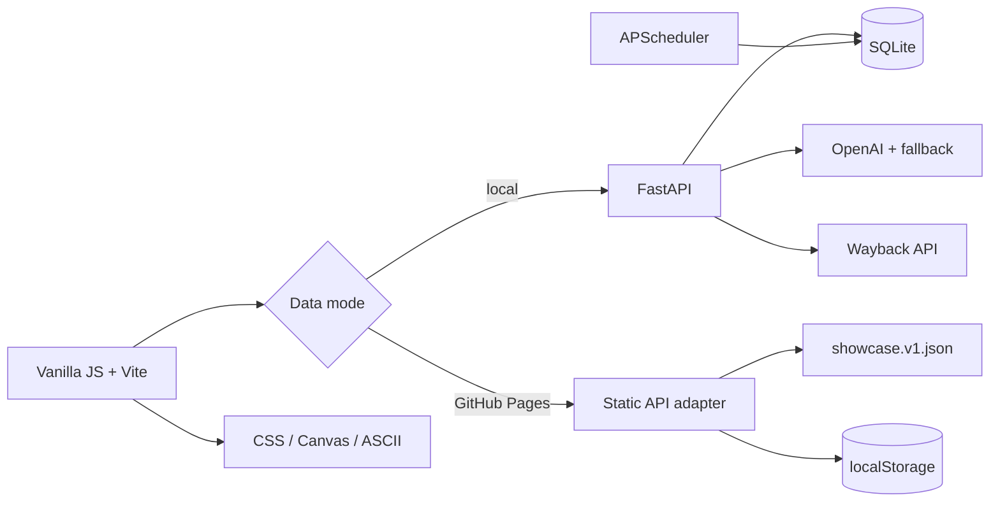

# 技术架构 / Technical Architecture



## 本地完整模式

FastAPI 在 lifespan 中创建表、初始化 AI 服务并启动 APScheduler。`run_decay_cycle()` 批量读取存活碑，以真实时间差推进熵值。阶段变化后才启动 AI 损坏任务；数据库提交完成后才启动跨会话 AI 更新，避免凭证尚未可见时发生竞态。

SQLite 模型包括 `Monument`、`ExtinctionCertificate`、`MaintenanceLog`、`CondoleLog` 和 `AppSettings`。展示数据使用保留的 UUIDv5 命名空间和固定展示用户 ID，重复 seed 只更新该命名空间。

## GitHub Pages 模式

Pages 不运行 Python。构建时 `VITE_DATA_MODE=static`，统一 `api.js` 选择 `static-api.js`：

- 首次读取 `public/mock/showcase.v1.json`；
- 复制为浏览器状态，并将访客操作写入版本化 localStorage；
- 使用同一阈值、倍率、维护公式和凭吊上限；
- 新碑、寂灭凭证和演示模式均在当前浏览器内工作；
- fixture 版本或 seed 变化时安全重建状态。

Hash 路由避免 Pages 刷新子页面时需要服务器 rewrite。Vite `base` 由 workflow 根据仓库名计算。

## 熵增公式

```text
elapsed_hours = (now - last_decay_at) / 3600
noise ∈ [-0.1, +0.2]
multiplier = 720 (demo) or 1 (real)
delta = decay_rate × elapsed_hours × multiplier × (1 + noise)
entropy = min(1, entropy + delta)
```

维护：`rollback = 0.05 × (1 - entropy)²`。凭吊：单次最多 `0.03`，生命周期总计最多 `0.15`。

## 数据与安全边界

- `.env`、SQLite 和虚拟环境被 Git 忽略。
- 对象详情与擦拭接口检查会话所有者；公共接口单独输出脱敏模型。
- 展示链接使用保留的 `.invalid` 域名，避免请求真实失效站点。
- Pages 无共享认证或服务端限流；localStorage 数据不是跨设备档案。
- APScheduler 仅适合单进程 MVP；生产多副本部署应迁移到单独 worker 或加分布式锁。

## 关键目录

- `backend/mock_data.py`：确定性生成、校验与幂等 seed。
- `scripts/mock_data.py`：CLI。
- `frontend/public/mock/showcase.v1.json`：Pages 与本地共用 fixture。
- `frontend/src/static-api.js`：浏览器本地 API 契约实现。
- `.github/workflows/ci.yml`、`pages.yml`：持续验证和部署。
